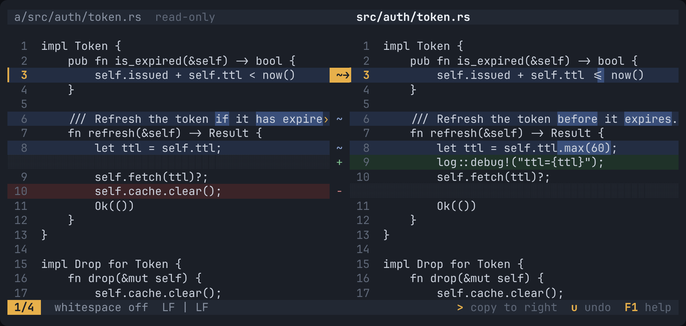
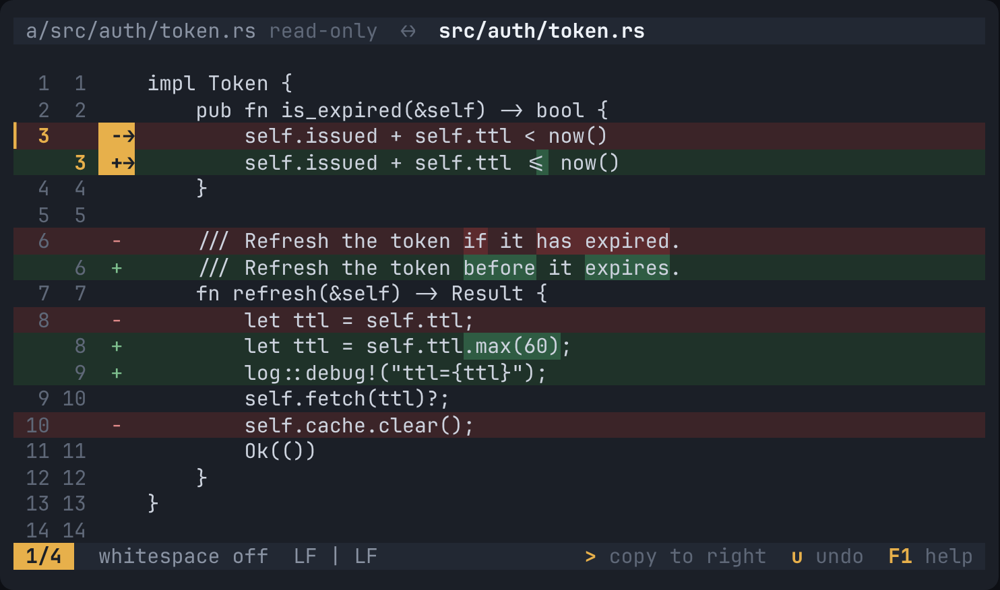
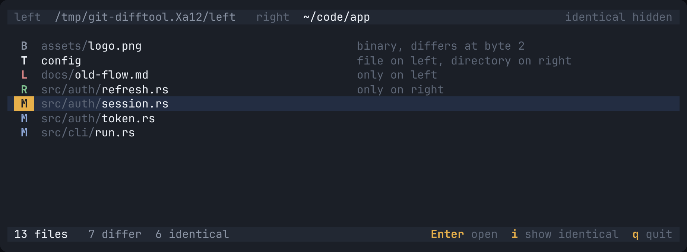
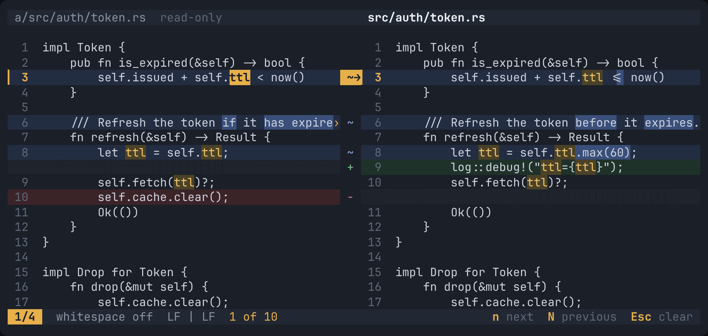

# wenas

A fast, minimal terminal diff tool that replaces Meld for two-way comparison.

`wenas` compares two files or two directories side by side, copies changes between them, and saves the result. It is a single static binary that starts instantly and runs entirely in the terminal. It is built for one workflow above all others: **`git difftool -d`** in a Ghostty + tmux + Neovim setup.



## Why not `nvim -d`?

`nvim -d` already gives you a fast side-by-side diff. `wenas` adds the parts of Meld you miss, with no setup:

- a **gutter** between the panes that shows which way each hunk can be copied
- **word-level highlighting** inside changed lines, on by default
- **one keystroke per hunk** (`>` copies right, `<` copies left)
- a **directory view** that streams results while it scans
- **instant startup**, with no editor configuration to load

## Install

```sh
# Homebrew (macOS and Linux)
brew install binara-sachin/tap/wenas

# Prebuilt binary
curl --proto '=https' --tlsv1.2 -LsSf \
  https://github.com/binara-sachin/wenas/releases/latest/download/wenas-installer.sh | sh

# From source (Rust 1.88 or newer)
cargo install wenas
```

Binaries are built for macOS (Apple Silicon and Intel) and Linux (x86_64 and arm64, statically linked).

## Use it with git

`wenas --git-config` prints the snippet to add to `~/.gitconfig`. It never edits your config itself.

```ini
[diff]
    tool = wenas
[difftool]
    prompt = false
    trustExitCode = true
[difftool "wenas"]
    cmd = wenas "$LOCAL" "$REMOTE"
[alias]
    dd = difftool --dir-diff
```

Then `git dd` opens one session with the list of changed files. Open a file with `Enter`, copy hunks, save with `w`, and go back with `Backspace`. Edits to the working-tree side land in your real files. The old side that git extracts is marked read-only automatically.

`trustExitCode` goes under `[difftool]`, not under `[difftool "wenas"]`: git ignores it in the per-tool section. With it set, `Ctrl-c` (exit code 1) stops a per-file `git difftool` run.

You can also compare anything directly:

```sh
wenas old.rs new.rs
wenas dir-a dir-b
wenas <(git show HEAD~3:src/main.rs) src/main.rs   # pipes are read-only
```

## Screens

| Unified view (narrow terminals, or `v`) | Directory view |
|---|---|
|  |  |



## Keys

| Key | Action |
|---|---|
| `j` `k` `↓` `↑` | Move the cursor |
| `Ctrl-d` `Ctrl-u` | Half a page down or up |
| `gg` `G` | Top or bottom |
| `J` `K` (or `]c` `[c`) | Next or previous hunk |
| `←` `→` (or `zh` `zl`) | Scroll both panes sideways |
| `Tab` | Switch the focused pane |
| `>` `<` | Copy the current hunk to the right or left |
| `u` `Ctrl-r` | Undo or redo |
| `e` | Open `$EDITOR` on the focused file at the cursor line |
| `/` `?` `n` `N` | Search and step through matches |
| `v` | Switch between side by side and unified |
| `W` | Cycle whitespace: off, ignore amount (`-b`), ignore all (`-w`) |
| `w` | Save the changed sides |
| `q` `Q` | Quit (asks if unsaved) or quit without saving |
| `Ctrl-c` | Abort with exit code 1 |
| `Esc` | Cancel a running scan or diff, clear the search |
| `F1` | Help |

In the directory view: `j` `k` move, `Enter` opens, `i` shows identical files, `/` searches names, `q` quits.

## Options

```
wenas [OPTIONS] <LEFT> <RIGHT>

  --label-left <TEXT>, --label-right <TEXT>   Pane titles instead of paths
  --readonly-left, --readonly-right           Force a side read-only
  -w, --ignore-all-space                      Ignore all whitespace
  -b, --ignore-space-change                   Ignore changes in the amount of whitespace
  --unified                                   Start in unified view
  --show-identical                            Directory view: show identical files
  --config <PATH>                             Use this config file
  --git-config                                Print the git configuration snippet
```

`-` reads one side from stdin. Sides read from stdin or a pipe are always read-only.

**Exit codes:** `0` for a normal quit, or when the inputs are identical (it prints `identical` and exits without opening the UI). `1` when aborted with `Ctrl-c`. `2` for an error, such as an unreadable file, mismatched argument types, output that is not a terminal (use `git diff --no-index` for non-interactive diffs), or a file over 1 GB.

## Configuration

Optional, at `~/.config/wenas/config.toml` on both macOS and Linux. A missing file means defaults, and unknown keys warn without failing.

```toml
theme = "auto"              # "auto" | "dark" | "light"
tab_width = 4
whitespace = "off"          # "off" | "change" | "all"
unified_below_columns = 100

[colors]
# changed_bg = "#2a2f3a"
# changed_word_bg = "#45506a"

[directory]
exclude = [".git", "node_modules", "target"]
show_identical = false
```

The theme is detected by asking the terminal for its background colour (inside tmux it defaults to dark). `NO_COLOR` is respected: changes are then shown with gutter markers and reverse video only. The `[colors]` names are listed in [the spec](docs/wenas-spec.md#112-config-file).

## What it does with your files

- Bytes you did not touch are never changed. Invalid UTF-8 is shown as `\xNN` and written back as it was.
- Saves are atomic (a temp file in the same directory, `fsync`, then rename) and follow symlinks, so edits made during `git dd` reach your working tree. Renaming over a file does break hard links to it.
- If a file changed on disk after you opened it, `wenas` asks whether to overwrite, reload or cancel.
- CRLF and LF are ignored when comparing. Copied hunks take the target file's line endings.
- Binary files and UTF-16 text show a binary screen instead of a diff.
- Files over 100 MB are confirmed first and files over 1 GB are refused.

## Performance

These are goals to measure, not gates (see [the spec](docs/wenas-spec.md#9-performance-targets)). The targets are for an Apple M4 Pro. The numbers below come from `cargo bench` on a 4-core Linux VM, so expect a recent Mac laptop to be faster. CI reports the same table on a macOS runner without ever failing the build.

| Measure | Target | Measured | |
|---|---|---|---|
| First screen, 10k-line files | ≤ 30 ms | 6.85 ms | ✅ |
| First screen, 100k-line files | ≤ 200 ms | 381.90 ms | ⚠️ |
| Copy a hunk and re-diff, 10k lines | ≤ 16 ms | 4.22 ms | ✅ |
| One frame while scrolling, 100k lines | ≤ 16 ms | 0.57 ms | ✅ |
| Directory compare, first result (50k files) | ≤ 100 ms | 2.24 ms | ✅ |
| Directory compare, full scan (50k files) | streamed | 1.74 s | |

The one miss is the first screen for 100k-line files. Almost all of that time is the histogram diff itself (about 480 ms; imara-diff's Myers does the same input in 3 ms, and `git diff --histogram` takes over a second). Inputs over 50,000 lines are diffed in the background, with a progress screen and `Esc` to cancel, so a large file never freezes the terminal.

## Not in v1

Three-way merge and `git mergetool`, syntax highlighting, line wrapping, copying part of a hunk, key remapping, a hex view and `--exit-code` are planned for later. See [the spec](docs/wenas-spec.md) for the full scope and the decision log.

## Development

```sh
cargo test                 # unit, property, snapshot and integration tests
cargo bench                # the measurements in the table above
./scripts/screenshots.sh   # regenerate docs/screenshots (needs Node + Playwright)
```

Releases are described in [RELEASING.md](RELEASING.md).

## License

Licensed under either of [Apache License 2.0](LICENSE-APACHE) or [MIT license](LICENSE-MIT) at your option.
